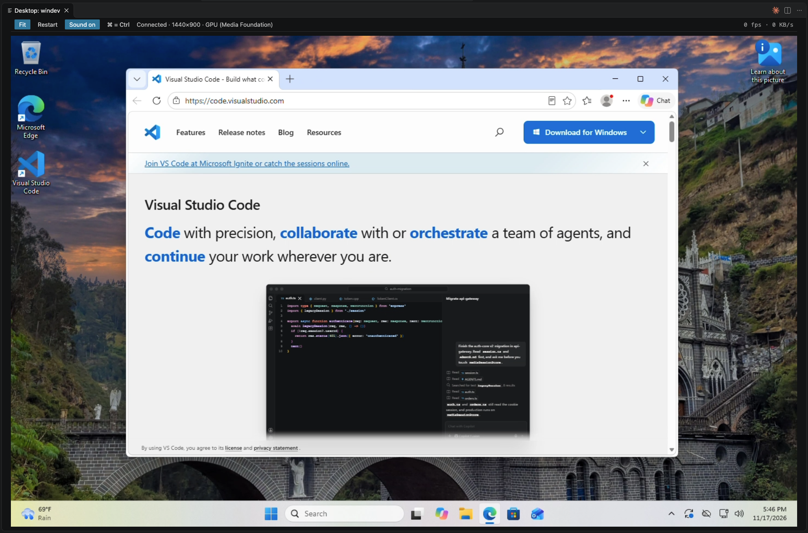

# Remote Desktop View

A Visual Studio Code extension that shows your remote Windows or Linux machine's desktop in an editor tab — with sound and a shared clipboard — and lets you control it, over the connection VS Code already has (Remote Tunnels, Remote-SSH or WSL).

No ports to open, no VPN, nothing to install on your own machine, no setup on the remote.

> **Preview.** Windows 10/11 remotes are supported, and Linux remotes running X11 with an NVIDIA GPU, or (experimental) an Intel or AMD GPU (see [Requirements](#requirements)). macOS remotes are planned.



## Features

### The Desktop in an Editor Tab

Open the remote desktop next to your code, split it, or drag it into its own window. Mouse, keyboard and scroll wheel work as you'd expect; the view scales to fit the tab or shows 1:1.

### Uses Your Existing Connection

The screen travels through VS Code's own connection to the remote, so whatever already works for your code — Remote Tunnels across the internet, Remote-SSH, WSL — works for the desktop too. Nothing listens on the network: the extension talks to its desktop server through a pipe.

### Video, Not Screenshots

The remote desktop is streamed as H.264 video, encoded by the remote machine's GPU and decoded by VS Code on your machine. It only sends frames when something changes, and uses a fraction of the bandwidth of VNC: a few hundred KB/s for everyday use at up to 60 fps.

- **Windows:** the GPU's encoder (Intel Quick Sync, NVIDIA NVENC, AMD — whatever Windows provides), fed straight from video memory. Machines without a hardware encoder use the H.264 encoder built into Windows.
- **Linux:** NVIDIA's NVENC, or VA-API on Intel and AMD GPUs (experimental), at up to 4K.

### Sound

Click **Sound** to hear the remote machine's audio (Opus, low latency).

### Clipboard Both Ways

Text copied on the remote desktop lands on your clipboard, and your clipboard is sent to the remote when you paste there or switch to the tab.

### Mac Keyboards

On a Mac, ⌘ acts as Ctrl on the remote by default, so ⌘C, ⌘V and ⌘Z do what you expect. Switch it to the Windows key with the **⌘ = Ctrl** button or the `vncDesktopView.commandKey` setting.

### Recovers by Itself

Resolution changes, the Windows lock screen, UAC prompts and GPU resets are handled without closing the tab: the picture pauses with an explanation and comes back on its own.

## Requirements

- VS Code 1.90 or later on your machine, connected to the remote machine with **Remote Tunnels**, **Remote-SSH** or **WSL**
- A remote machine with someone signed in to its desktop:

### Windows

- Windows 10 or 11 (x64)

### Linux

| | Requirement |
|---|---|
| System | x64, glibc 2.34 or newer (Ubuntu 22.04+, Debian 12+, Linux Mint 21+, Fedora 35+, RHEL / Rocky 9+) |
| Desktop session | **X11 (Xorg).** Any desktop environment: Cinnamon, Xfce, MATE, KDE Plasma on X11, GNOME on Xorg, … Wayland sessions aren't supported yet; on GNOME or KDE, pick the X11 / Xorg session on the login screen. |
| GPU | **NVIDIA** GPU with NVIDIA's driver, version 530 or newer (NVENC), or *(experimental, not yet tested on real hardware)* an **Intel or AMD** GPU whose VA-API driver can encode H.264: Intel's `intel-media-va-driver` (iHD) or `i965-va-driver`, or Mesa's `radeonsi` for AMD. Some distributions (e.g. Fedora, openSUSE) build Mesa without H.264 encoding; there you need their "freeworld" Mesa VA drivers. The open-source nouveau driver for NVIDIA isn't supported. |
| Screen size | At most 4096 × 4096 pixels — all monitors together, since X11 treats them as one screen |
| Sound (optional) | PulseAudio, or PipeWire with its PulseAudio server (most desktops). Without it, everything but sound works. |

Nothing needs to be installed on Linux: the desktop server only depends on the C library, and uses the GPU driver and the sound server that are already there. It finds the logged-in desktop session itself. With both an NVIDIA and an Intel / AMD GPU, NVENC is used.

## Getting Started

1. Connect VS Code to the remote machine and install the extension there (VS Code offers to install it on the remote side)
2. Run **Remote Desktop View: Open Desktop** from the Command Palette

## Settings

| Setting | Default | Description |
|---------|---------|-------------|
| `vncDesktopView.commandKey` | `ctrl` | Mac only: what ⌘ sends to the remote desktop (`ctrl`, or `windows` = the Windows / Super key) |

## Security & Privacy

- **No telemetry.** The extension sends nothing anywhere. Screen, sound, keyboard, mouse and clipboard data only travel over your existing VS Code remote connection.
- **Nothing exposed.** The desktop server runs as your user, only while a desktop tab is open, and talks to the extension over its standard input and output. It opens no network ports.
- **No changes to the remote machine.** Nothing is installed or configured; the desktop server ships inside the extension.
- **Clipboard.** Text is synced only while a desktop tab is open, up to 1 MB.
- **Sound.** On Linux the remote's sound is only recorded while **Sound** is on.

## Known Issues

- **Windows: lock screen and UAC prompts** can't be shown or controlled yet (Windows reserves them for system processes); the tab shows a notice until the desktop returns
- **Windows: administrator windows** don't receive mouse and keyboard input while they have focus (Windows blocks input from ordinary programs into elevated ones)
- **Linux: Wayland and screens over 4096 pixels** aren't supported yet (see [Requirements](#linux))
- **Linux: Intel / AMD GPUs (VA-API)** are experimental and haven't been tested on real hardware yet. If the tab shows an encoder error, please [report it](https://github.com/rderr/vnc_desktop_view/issues) with the **Remote Desktop View** output
- **Keyboard shortcuts** that VS Code handles itself (such as ⌘W / Ctrl+W) don't reach the remote
- **After a reboot**, the remote is only reachable once someone has logged in (VS Code's tunnel starts at login)

## Development

### Prerequisites

- Node.js 20+
- VS Code 1.90+
- For the desktop server: Rust, and CMake (used to build libopus). On Windows, the Visual Studio C++ build tools (which include CMake); on Linux, a C compiler and CMake.

### Build

```bash
npm install
npm run build                                       # extension and viewer
cargo build --release --manifest-path server/Cargo.toml   # desktop server
```

### Run

Press **F5** in VS Code to launch the Extension Development Host. Over Remote Tunnels the debugger may fail to attach; use **Run Without Debugging** (Ctrl+F5) instead. A development checkout runs the server from `server/target/release`.

### Package

```bash
npm run package
```

Builds the desktop server and the package for the platform it runs on:

- On Windows: `…-win32-x64.vsix`, plus the universal `.vsix` for platforms without a server
- On Linux: `…-linux-x64.vsix`

`npm run publish` builds and publishes them; run it on both systems for a release.

### Project Structure

```
src/
├── extension.ts              # Commands
├── videoSession.ts           # One desktop tab: runs the server, flow control, clipboard
├── videoProtocol.ts          # Messages between the tab and the extension
└── webview/
    ├── video.ts              # Viewer: WebCodecs H.264, input, toolbar
    ├── audio.ts              # Opus playback (WebAssembly decoder)
    └── scancodes.ts          # Keyboard codes -> Windows scan codes
server/src/                   # Desktop server (Rust)
├── main.rs                   # Capture loop and stdin/stdout protocol
├── encoder.rs                # Encoder interface and selection
├── convert.rs                # CPU color conversion (BGRA -> NV12)
├── win/                      # Windows
│   ├── capture.rs            # DXGI Desktop Duplication
│   ├── gpu.rs                # BGRA -> NV12 on the GPU
│   ├── mf.rs                 # Media Foundation H.264 encoders
│   ├── audio.rs              # WASAPI loopback -> Opus
│   ├── input.rs              # Mouse and keyboard (SendInput)
│   └── clipboard.rs          # Clipboard sync
└── linux/                    # Linux (X11)
    ├── display.rs            # Finds the logged-in desktop session
    ├── capture.rs            # MIT-SHM screen grabs, driven by DAMAGE
    ├── nvenc.rs              # NVIDIA NVENC H.264 (nvenc_sys.rs: API bindings)
    ├── vaapi.rs              # Intel / AMD VA-API H.264 (va_sys.rs: API bindings)
    ├── audio.rs              # PulseAudio monitor -> Opus
    ├── input.rs              # Mouse and keyboard (XTEST)
    └── clipboard.rs          # CLIPBOARD selection sync
scripts/
├── package.mjs               # Builds the server and this platform's package(s)
├── build-notices.mjs         # Generates ThirdPartyNotices.txt
└── server-notices.mjs        # Licenses of the server's Rust crates
```

## License

See [LICENSE](LICENSE) for details. Bundled third-party code is listed in [ThirdPartyNotices.txt](ThirdPartyNotices.txt).
